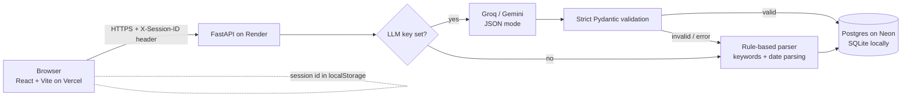

# MindClear AI

[](https://github.com/mohammed-samiul-islam/MindClear-AI/actions/workflows/ci.yml)
[](LICENSE)

Turn a messy "brain dump" into clear, categorized tasks. Paste something like

> call mom tomorrow, pay rent by Oct 30. urgent: finish client report today; maybe read a book someday

and get back tasks with a **category** (Work / Personal / Health / Finance / Other), a **priority**
(High / Medium / Low) and a **deadline**, which you can filter, complete and delete.

**Live demo:** _coming soon_ <!-- replace with your Vercel URL -->

## Tech stack

- **Backend:** FastAPI, SQLAlchemy 2, Pydantic v2, httpx. SQLite locally, Postgres (Neon) in production.
- **Frontend:** React 18, Vite, Tailwind CSS, React Router.
- **AI:** Groq (OpenAI-compatible, free tier) or Google Gemini (free tier), with a rule-based fallback.
- **Quality:** pytest suite, GitHub Actions CI (backend tests + frontend build).

## How the AI part actually works (and when it doesn't)

Being explicit, because "AI-powered" is easy to overclaim:

1. If an LLM key is configured (`GROQ_API_KEY`, or `GEMINI_API_KEY`), the backend sends the text to
   that provider and asks for **JSON output** (`response_format: json_object` on Groq,
   `responseMimeType: application/json` on Gemini). Today's date is included in the prompt so
   "tomorrow" / "next friday" resolve correctly.
2. The response is validated **strictly** with Pydantic: only the allowed categories/priorities, no
   extra keys, non-empty task text, deadlines must be real ISO dates within a sane range.
3. On **any** failure (no key, timeout, HTTP error, rate limit, invalid JSON, schema violation) the
   backend falls back to a **deterministic rule-based parser**:
   - splits the text on newlines, bullets, semicolons, sentences and commas (keeping `Oct 5, 2026` intact);
   - assigns a category by keyword scoring (e.g. *rent, bill, tax* → Finance; *gym, dentist* → Health);
   - assigns priority from urgency words (*urgent, asap, today* → High; *maybe, someday* → Low) or,
     failing that, from how close the deadline is;
   - parses deadlines: today/tonight, tomorrow, day after tomorrow, weekdays (*friday, next tue*),
     next week, this weekend, end of week/month, *in 3 days*, ISO dates, `11/5`, `March 5`, `5th of November`.

Every `/analyze` response includes `"source": "groq" | "gemini" | "rules"`, and `/health` reports
which provider is configured, so you can always tell which path produced the result. The fallback is
keyword-based, so it will misclassify things a human (or an LLM) would get right; it's there so the app
stays usable and free with no key at all.

## Architecture



### Per-visitor isolation

There are no accounts. On first visit the frontend generates a random ID (`crypto.randomUUID()`),
stores it in `localStorage`, and sends it as an `X-Session-ID` header on every request. Every
task/conversion query is filtered by that ID, and touching another session's task returns 404. This
keeps public-demo visitors from seeing each other's data. It is **not** authentication: anyone who
knows an ID can use it, and clearing browser storage starts a new, empty session.

## API

| Method | Path | Description |
|---|---|---|
| `POST` | `/analyze` | `{"text": "..."}` → `{conversion_id, source, tasks[]}` |
| `GET` | `/tasks` | Filters: `category`, `priority`, `completed`, `conversion_id` |
| `PATCH` | `/tasks/{id}` | `{"completed": true}` |
| `DELETE` | `/tasks/{id}` | Delete a task |
| `GET` | `/conversions` | Brain-dump history with task counts |
| `GET` | `/health` | Status + configured LLM provider |

All endpoints except `/health` and `/` require the `X-Session-ID` header (16–64 chars, `[A-Za-z0-9_-]`).
Interactive docs: `http://localhost:8000/docs`.

## Local setup

Requirements: Python 3.11+ and Node 20+.

```bash
git clone https://github.com/mohammed-samiul-islam/MindClear-AI.git
cd MindClear-AI

# Backend
cd backend
python -m venv .venv && source .venv/bin/activate   # Windows: .venv\Scripts\activate
pip install -r requirements-dev.txt
cp ../.env.example .env        # optional: add GROQ_API_KEY; without it the rule-based parser is used
uvicorn app.main:app --reload  # http://localhost:8000

# Tests
pytest -q

# Frontend (new terminal)
cd frontend
npm ci
npm run dev                    # http://localhost:5173 (proxies /api -> :8000)
```

### Environment variables

| Name | Where | Default | Notes |
|---|---|---|---|
| `DATABASE_URL` | backend | `sqlite:///./dev.db` | Neon URL in production |
| `LLM_PROVIDER` | backend | `auto` | `auto` \| `groq` \| `gemini` \| `none` |
| `GROQ_API_KEY` | backend | – | free key from console.groq.com |
| `GROQ_MODEL` | backend | `llama-3.1-8b-instant` | |
| `GEMINI_API_KEY` | backend | – | free key from aistudio.google.com |
| `GEMINI_MODEL` | backend | `gemini-2.5-flash` | |
| `LLM_TIMEOUT_SECONDS` | backend | `20` | |
| `CORS_ORIGINS` | backend | localhost:5173,3000 | comma-separated frontend origins |
| `VITE_API_URL` | frontend (build time) | `/api` | backend URL in production, no trailing slash |

See [docs/DATABASE.md](docs/DATABASE.md) for database notes (an old `dev.db` must be recreated).

## Free-tier deployment (Neon + Render + Vercel + Groq)

1. **Groq key:** sign in at <https://console.groq.com>, create an API key. (Alternatively a Gemini key
   from <https://aistudio.google.com/apikey>.) Skipping this is fine; you get the rule-based parser.
2. **Neon Postgres:** create a project at <https://neon.tech>, copy the **pooled** connection string
   (`postgresql://…-pooler…/neondb?sslmode=require`).
3. **Render backend:** New → **Blueprint** → select this repo; Render reads `render.yaml`
   (service `mindclear-api`, root `backend/`, free plan). Fill in `DATABASE_URL`, `GROQ_API_KEY`, and
   leave `CORS_ORIGINS` for step 5. Check `https://<service>.onrender.com/health`.
4. **Vercel frontend:** New Project → import this repo → **Root Directory `frontend`** (framework
   Vite is detected; `vercel.json` adds SPA rewrites so `/dashboard` refreshes work). Add env var
   `VITE_API_URL=https://<service>.onrender.com` and deploy.
5. Back in Render, set `CORS_ORIGINS=https://<your-app>.vercel.app` and redeploy.
6. Put the Vercel URL in the **Live demo** line above.

Free-tier caveats: Render free services sleep after inactivity (first request can take ~a minute),
Neon free compute auto-suspends, and Groq/Gemini free tiers are rate-limited; when limits are hit the
app automatically falls back to the rule-based parser.

## Project structure

```
backend/
  app/
    main.py            FastAPI app, CORS, routers
    ai_service.py      Groq/Gemini calls, strict validation, fallback
    rule_parser.py     keyword classifier + item splitting
    date_parser.py     natural-language deadline parsing
    dependencies.py    DB session + X-Session-ID dependency
    models.py schemas.py database.py config.py routers/
  tests/               pytest suite
frontend/              React + Vite + Tailwind app (vercel.json)
render.yaml            Render blueprint
.github/workflows/ci.yml
```

## License

[MIT](LICENSE) © 2026 Mohammed Samiul Islam
